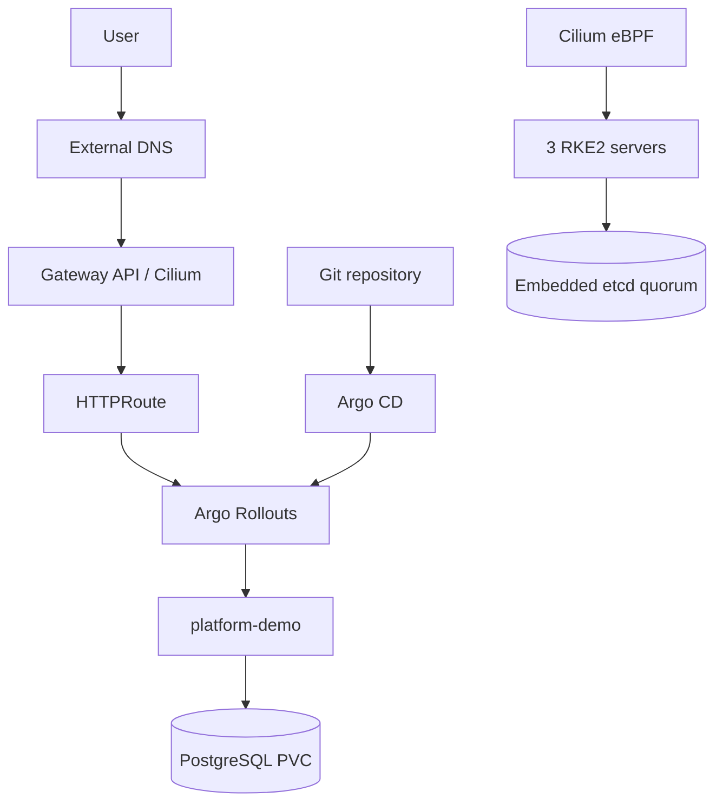

# Architecture

Three control-plane nodes provide an etcd quorum of two and tolerate one node
failure. RKE2 servers use the control-network IP for the supervisor and API
traffic. Cilium is the sole CNI, uses native routing, and replaces kube-proxy.

The platform boundary is deliberate: RKE2, Cilium, CoreDNS, and kube-system
components are bootstrapped operationally; application resources live under
`gitops/apps` and are reconciled by Argo CD.
