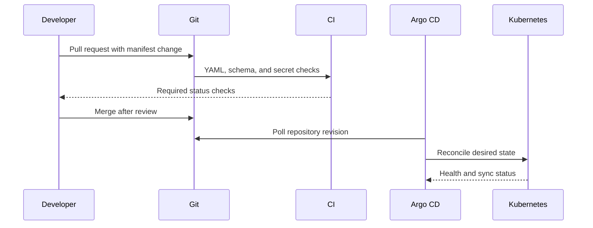

# GitOps flow

Git is the source of truth. Argo CD uses a pull-based reconciliation loop with
prune and self-heal enabled for the root application. Direct changes made for an
incident are temporary and must be represented by a follow-up Git commit.
